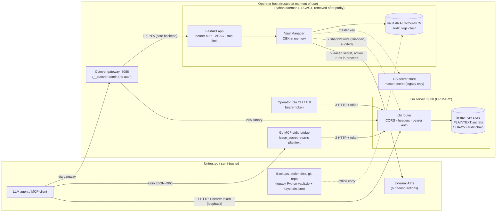

# Threat Model

This document states, in concrete terms, what `rgt-vault` defends against and
what it does not. It complements [SECURITY.md](../../.github/SECURITY.md), which
holds the formal guarantees and the disclosure process. When the two disagree,
SECURITY.md governs.

## Which line this describes

Direction (2026-11-26): the **Go line (`go/`) is the only maintained target**.
The Python implementation (`python/`, imported as `rgt_vault`) is end-of-life:
it receives no new features and will be removed once Go reaches parity. This
threat model therefore describes the Go line as the product, and uses the
Python code as the **legacy reference** for controls that exist in code today
but that Go has not implemented yet. Every such difference is marked
**`Gap (Go)`**; the full list is in [Parity gaps](#parity-gaps-gap-go) below.

Every statement was checked against the code on the commit that introduced
this revision. Where the code does not do what earlier documentation implied,
this page says so and links the tracking issue. Re-check a claim against the
code before relying on it. This file is reviewed whenever a PR ticks the
"threat-model impact" box (see
[CONTRIBUTING](../../.github/CONTRIBUTING.md#security-development-lifecycle)).

Related pages: [Trust boundary](../concepts/trust-boundary.md),
[Architecture overview](../architecture/overview.md),
[Cryptography](../architecture/crypto.md), [ADRs](../adr/README.md),
[API reference](../guides/api.md), [ASVS V1 evidence](asvs/V1.md).

## Components in scope

| Component | Where | Status on this commit |
|---|---|---|
| **Go server** (primary) | `go/cmd/server`, `go/internal/server`; also started by `rgt-vault serve` in `go/cmd/rgt-vault` | A skeleton: secrets live in an **in-memory, plaintext** map; policy simulation is hard-coded allow-all; no persistence, no encryption, no TLS (`handlers.go` `Store`, `SimulatePolicy`) |
| **Go CLI / TUI** | `go/cmd/rgt-vault` (set, get, list, revoke, simulate, fingerprint, rotate, verify-audit, audit, init, serve, status, mcp, tui), `go/internal/tui` | HTTP clients of the server; hold the bearer token |
| **Go crypto / KDF libraries** | `go/internal/crypto`, `go/internal/kdf` | AES-256-GCM and Argon2id helpers, wire-compatible with the legacy Python format and unit-tested, but **not imported by any non-test Go code**: the server does not use them |
| **MCP bridge** | `go/internal/mcp` (`rgt-vault mcp`) | stdio JSON-RPC server; its `lease_secret` tool **returns plaintext to the MCP client** |
| **Cutover gateway** | `go/cmd/gateway`, `go/internal/gateway` | Reverse proxy that routes a percentage of traffic to the Go server and the rest to the Python server; `/__cutover` admin paths |
| **Outbound guard** | `go/internal/netguard` | Dialer that blocks link-local always and non-loopback unless opted in |
| Python vault + HTTP daemon (**legacy**) | `python/` (`python -m rgt_vault.cli serve`, FastAPI) | The only implementation with real encrypted storage, ABAC, audit chain, approvals and capability tokens. Behaviour the Go line must reach, until it is removed |
| Python MCP server (**legacy**) | `python/server/mcp_server.py` | Fails closed (no capability token, empty policy); not a supported path |
| OS master-secret providers (**legacy**) | `python/providers/*`, `python/keychain.py` | DPAPI, macOS Keychain, Linux TPM tools, Secret Service. **Gap (Go)**: the Go line has no master-secret provider |

## Assets

1. **Secret plaintext** (API keys, tokens, passwords) — highest value.
2. **Data Encryption Key (DEK)** — decrypts all secrets. **Gap (Go)**: the Go
   server has no DEK; secrets are not encrypted.
3. **Master secret** — root of trust, held by an OS-native store. **Gap (Go)**:
   none exists in Go.
4. **Bearer tokens** — authenticate callers. In both lines this is a single
   token stored **in plaintext** in a file and compared in constant time
   (`go/internal/auth/token.go`; `python/server/auth.py`).
5. **Capability-token HMAC key and TOTP secret** — mint/verify capability
   tokens and approve 2FA-flagged requests. **Gap (Go)**: neither exists in Go.
6. **Audit log integrity** — evidence of access.
7. **Policy file** — decides who may do what. **Gap (Go)**: Go has no policy
   engine.

### Data classification and protection requirements

Satisfies the "classify sensitive data and attach protection requirements"
asks (RGT-249, RGT-250). The levels are the project's own; there is no
external regulatory classification. The "Required" columns are the target for
the Go line; the "Go today" column says where it falls short.

| Level | Data | Required at rest | Required in transit | Required in memory | Retention / audit | Go today |
|---|---|---|---|---|---|---|
| **L1 — Critical** | Secret plaintext; DEK; master secret | Never plaintext: AES-256-GCM under the DEK with AAD `vault_id:namespace:name`; DEK wrapped under an Argon2id+HKDF key from the master; master in the OS store | TLS; plaintext never returned by `/use` or capability execution | Wiped after use; copies are best effort | Superseded versions retained, no auto-purge; every read/use audited | **Gap (Go)**: plaintext in RAM, not persisted, no TLS, and `GET /v1/secrets` plus MCP `lease_secret` hand the value to the caller |
| **L2 — Credentials** | Bearer tokens; capability HMAC key; TOTP secret | File mode 0600; ideally stored hashed | TLS | Process memory | Expiring, rotatable | Token file is 0600 but plaintext, never expires, rotation is "delete the file"; `cmd/server` prints the full token to stdout/logs (RGT-409/259) |
| **L3 — Integrity-critical** | Policy; audit log; wrapped-key file; key epoch | Hash-chained audit; keyed or externally anchored for tamper evidence | n/a | n/a | Audit retained indefinitely | In-memory audit chain, unkeyed, lost on restart. No policy, no keychain file |
| **L4 — Operational** | Secret names, namespaces, agent ids, purposes, client IP, token id | Not secret, but not published | TLS | n/a | Same as audit | In memory only |

Protection requirements that no line meets today: TLS (RGT-251/455/456),
hashed/expiring tokens (RGT-320/318), authenticated failure auditing
(RGT-233/413).

## Data-flow diagram



Trust boundaries (numbered flows above cross one):

| # | Boundary | Authentication today | Notes |
|---|---|---|---|
| 1 | Agent → Go server | One shared bearer token; the acting `agent` is a **client-supplied body field** and is not checked against anything | **Gap (Go)**: no per-agent identity, no policy |
| 2 | MCP bridge → Go server | Bearer token (the server prints the full token at start) | One token for every MCP caller |
| 3 | Operator → Go server | The same bearer token as agents | **Gap (Go)**: no operator scope, no approvals, no TOTP (legacy Python has `/v1/requests*` and `--operator-token-file`) |
| 5 | Vault → external API | **Gap (Go)**: the Go server has no outbound actions (`/use` is a stub); legacy Python sends the secret as a Bearer token with default TLS verification | |
| 7 | Python → Go shadow write | Bearer token | Migration path only; failure is audited, Python stays source of truth |

Flow 4 (process → disk) and 6 (hook → webhook) exist only in the legacy Python
vault. **Gap (Go)**: the Go server never touches disk or a webhook.

## Trust boundaries (summary)

```
                 untrusted                 |            trusted
   ┌───────────────────────────────┐       |   ┌───────────────────────────┐
   │ backups, stolen disk, git repo │       |   │ live process memory        │
   │ (any persisted vault files)    │  ───► |   │ keys, leased plaintext     │
   └───────────────────────────────┘       |   └───────────────────────────┘
                                            |   ┌───────────────────────────┐
                                            |   │ OS secret store (master)   │
                                            |   └───────────────────────────┘
```

The line moves the moment an attacker gains code execution in the process or
root on the host. See [Trust boundary](../concepts/trust-boundary.md) for the
same-user (soft) versus separate-account (hard) deployment postures.

## Protects against

The first three items describe the **target** protections and are implemented
today only in the legacy Python vault. **Gap (Go)**: the Go server provides none
of them, because it does not persist or encrypt.

- **Git leaks / committed databases.** Committing `vault.db` exposes only
  AES-256-GCM ciphertext; without the master secret it is not decryptable.
- **Stolen backups / lost disks.** Ciphertext at rest is bound to a DEK that is
  itself wrapped under an Argon2id-stretched master key.
- **Ciphertext tampering / swapping.** AAD (`vault_id:namespace:name`) makes
  edited or swapped ciphertext fail authentication.

What the Go line does provide today:

- **Secrets are not written to disk** by the server (they exist only in RAM).
- **Constant-time token comparison** and a short token id in logs
  (`go/internal/auth`).
- **Security response headers** (CSP `default-src 'none'`, `nosniff`,
  `X-Frame-Options: DENY`, `Referrer-Policy: no-referrer`) and removal of
  `Server` / `X-Powered-By` (`middleware.go`).
- **SSRF-safe dialer** for the MCP bridge, TUI and CLI clients
  (`netguard`): link-local and cloud-metadata addresses are always refused.

## Partially protects against

- **Prompt injection that tries to exfiltrate a secret.** Legacy Python: the
  `/use` and capability endpoints never return the value, ABAC limits which
  agent/purpose can use which namespace, honeytokens raise a critical
  `HONEYTOKEN_TRIGGERED` row, rate limits cap mass extraction. This holds
  against an agent that follows the API, not one that lies about its name (see
  [Privilege escalation](#privilege-escalation)). **Gap (Go)**: Go has no
  ABAC, no honeytokens, no rate limit, and two paths that return plaintext.
- **Local malware / compromised user account.** An attacker running as the
  user can read the process, the token file and (legacy) the OS-store secret.
- **Memory disclosure of copies.** Plaintext copied into `str`/`bytes` (Python)
  or `string`/`[]byte` (Go) is not wiped.
- **Audit tampering by someone who can write the log.** The chain is plain
  (unkeyed) SHA-256 in both lines. Edits and mid-chain/head deletes are caught;
  **deleting the last N rows (tail truncation), emptying the log, rebuilding a
  fresh consistent chain, or changing a column outside the hash input
  (Python's `agent_id`) is not caught.** Verified by running the legacy Python
  code against a scratch database on 2026-11-26 (no regression test is kept
  for the end-of-life line); the Go chain uses the same construction over an
  in-memory slice (`Store.VerifyAuditChain`) and so shares the property by
  construction. In Go the log additionally disappears on every restart. **Gap
  (Go)**: no persistence, no external anchor, no keyed chain.
- **Full-backup rollback** (legacy). Restoring a matched old `vault.db` +
  `keychain.json` pair is not detected, because the epoch lives in the
  rolled-back database.

## Does not protect against

- **Root / Administrator compromise** of the host.
- **Kernel or hypervisor compromise.**
- **Memory scraping by a privileged attacker** (debugger, core dump, ptrace).
- **TPM/DPAPI/Keychain extraction attacks** against the OS store.
- **A malicious operator** (see [Malicious administrator](#malicious-administrator)).
- **Side channels** (timing, power, cache) against the primitives.
- **Network attackers on a non-loopback bind.** Neither server terminates TLS.
  The Go server binds `0.0.0.0:8080` by default (RGT-259), so out of the box it
  is reachable from the network.

## Threats added in this revision

### Nonce reuse

AES-256-GCM with a repeated (key, nonce) pair leaks the XOR of plaintexts and
the authentication subkey.

- **Go.** `go/internal/crypto` draws a fresh 12-byte nonce from `crypto/rand`
  per `Encrypt` call and prepends it to the ciphertext. That primitive is sound
  but **unused by the server**, so today's Go store has no ciphertext at all
  (**Gap (Go)**). When storage is wired in, the same bound applies as below, and
  the DEK usage counters and automatic rotation (RGT-219) that the Python vault
  has must be ported (**Gap (Go)**).
- **Legacy Python.** `crypto.encrypt` uses `os.urandom(12)`. With random 96-bit
  nonces the collision risk stays below the NIST SP 800-38D limit (2^-32) up to
  about 2^32 encryptions per key. `DEK_MAX_ENCRYPTIONS` (100,000,000) and
  `DEK_MAX_BYTES` (512 GiB) in `python/vault.py` trigger `rotate_dek()` far
  earlier; counters are persisted and bumped with SQL arithmetic inside one
  `BEGIN IMMEDIATE` transaction, so concurrent writers do not lose updates.
- **DEK wrap is different.** The nonce for wrapping the DEK in `keychain.json`
  is *derived* (HKDF over the Argon2id output, `python/keychain.py`), not
  random. That is safe only because every wrap first draws a fresh 32-byte salt
  from `os.urandom`, so the wrapping key and nonce are new each time. A future
  Go port must keep the "fresh salt per wrap" rule.
- **Residual risks.** A broken system CSPRNG (a cloned VM snapshot with a
  repeated entropy pool) defeats the random-nonce argument and neither line
  detects it. The one-time legacy migration rewrite is not counted toward the
  DEK limits (documented, deliberate).

### Privilege escalation

Intended privilege levels: **agent** (use/list secrets), **operator**
(approve/deny, rotate, audit) and **host root**.

| Path | Boundary that should hold | Go today | Legacy Python today |
|---|---|---|---|
| Agent → use a secret | Default-deny ABAC on `(agent, namespace, purpose, action)` | **Gap (Go)**: no ABAC; `SimulatePolicy` always allows; `/use` succeeds for any caller with the token | Enforced, but `agent` is a body field and all agents share one token (RGT-236/343/346) |
| Agent → approve its own request | Separate operator token + TOTP | **Gap (Go)**: no approval routes | Separate token only if `--operator-token-file` is given (RGT-235) |
| Agent → rotate keys, read/verify audit, simulate policy | Operator scope | **Gap (Go)**: any token holder can; rotate only bumps an epoch counter | Bearer token only; no operator scope (RGT-237/344/431) |
| Agent → drop a secret's 2FA requirement | Immutable once set, or operator-only | **Gap (Go)**: no `require_2fa` | New version with `require_2fa=false` replaces it (RGT-341/348/350) |
| Caller → skip capability-token verification | Verification cannot be bypassed | **Gap (Go)**: no capability tokens | `bypass_verification` keyword on `execute_capability` (in-process only, RGT-423) |
| Network caller → gateway admin | Operator only | `/__cutover` and `/__cutover/stats` need no credentials (RGT-162) | n/a |

Practical consequence: with one shared bearer token and a self-asserted agent
name, the API boundary stops a well-behaved or prompt-injected agent but not
one that holds the token and picks another identity. Per-agent identity and
scopes (RGT-236 and the identity batch) are the fix; until then, use the hard
posture in [Trust boundary](../concepts/trust-boundary.md).

### Malicious administrator

An administrator is anyone who controls the policy, the master secret, the
daemon account, the operator token or the audit store.

- Can read every secret. Not defended.
- Can rewrite or truncate the audit log undetectably (unkeyed chain; tail
  truncation and a full wipe pass verification). Legacy: `import_vault` deletes
  `secrets`, `audit_logs` and `honeytokens` and replaces them from a payload
  whose only integrity check is a `vault_id` string (RGT-377).
- Can approve any request with the operator token (legacy). In Go the same
  token already does everything.
- Controls `APP_ENV`, CORS (`CORS_ALLOWED_ORIGINS`), bind address and token
  files.

Mitigations are procedural: separate operator and agent accounts, keep the
operator token off the agent host, ship the audit tail to an append-only sink
(see SECURITY.md "Audit Chain Limitations"), and treat the operator machine as
the root of trust. The project does not claim to defend against this actor.

### Supply chain

| Vector | Control that exists | Gap |
|---|---|---|
| Go dependencies | `go.mod`/`go.sum` pin versions and hashes; `govulncheck ./...` in `ci.yml`; Dependabot (`gomod`) | `go install ...govulncheck@latest` is unpinned; the job currently fails on Go stdlib advisories until the toolchain is bumped (RGT-261) |
| Go toolchain | `go 1.25.0` in `go.mod`, `actions/setup-go` in CI | Stdlib vulnerabilities need a newer patch release |
| Python dependencies (legacy) | `pip-audit` in CI; Dependabot (`pip`) | No hash-pinned lockfile; `requirements.txt` has three lower-bounded entries |
| CI actions | Dependabot updates action versions | Actions referenced by tag, not by commit SHA (`gitleaks-action@v2` carries a "pin to SHA in production" note) |
| Static analysis and tests | `bandit`, ruff, mypy, pytest (Python); `govulncheck` (Go); CodeQL on a **weekly schedule only**, Python only | **No `go vet` or `go test` job runs on pull requests**: `go test ./...` appears only in `release.yml`, i.e. on a tag. CodeQL/Scorecard `push`/`pull_request` triggers name `main` but the default branch is `master`; CodeQL does not analyze Go |
| Release artifacts | goreleaser release job, syft available for SBOMs (`release.yml`); CycloneDX job in `ci.yml` | No signing step in `release.yml`; signing/SBOM publication is in draft PR #15 (RGT-163) |
| Secret scanning | `gitleaks` in `review-gate.yml` | PR/push only |
| Malicious dependency update | Reviewed Dependabot PRs | Single maintainer; no second reviewer |

Tracked under RGT-261 / RGT-262 (CI health) and RGT-260 (signing).

### The Go server

Treat it as the primary but unfinished implementation, not as a vault yet:

- Secrets live in a Go `map` in process memory, **in plaintext**; no encryption
  at rest and no persistence (`handlers.Store`). `GET /v1/secrets` returns each
  secret's `value`.
- `SimulatePolicy` always answers `allowed: true`; there is no ABAC.
- `cmd/server` prints and logs the full bearer token, binds `:8080` on all
  interfaces, and reflects any `Origin` in CORS unless `APP_ENV=production`
  (`middleware.go`). The auth middleware builds its JSON error body by string
  concatenation, and `OPTIONS` is answered before auth for every path.
  Hardening is tracked in RGT-232, RGT-259, RGT-263, RGT-364, RGT-369, RGT-424
  and RGT-409/428.
- Request bodies are decoded with `json.NewDecoder(...).Decode` with no size
  cap and unknown fields accepted (RGT-352/357).
- The `rgt-vault serve` subcommand starts the same in-memory server using
  `~/.config/rgt-vault/server.token`, without printing the token.

### The cutover gateway

`go/internal/gateway` proxies to the Python and Go backends and exposes
`PUT/POST /__cutover?go=N` and `GET /__cutover/stats`. These admin paths have
**no authentication**, and `cmd/gateway` listens on `:8088` (all interfaces) by
default. Anyone who can reach the gateway can shift traffic to the Go server (a
downgrade from the Python vault's encrypted storage to the in-memory plaintext
store while Go is a stub) or read counters. The fix (operator token plus
loopback bind) is in RGT-162's scope. The gateway forwards `Authorization`
headers to both backends unchanged, and a failed Go request is silently
replayed against Python. The gateway is transitional: it is removed with the
Python line.

### MCP servers

- **Go bridge** (`go/internal/mcp`, `rgt-vault mcp`): stdio JSON-RPC 2.0.
  Tools: `list_secrets`, `lease_secret`, `revoke_secret`. `lease_secret`
  returns the secret **value** to the MCP client, i.e. to the agent, so "the
  agent never receives raw secrets" does **not** hold here ([MCP
  guide](../guides/mcp.md) says so). One token serves every tool call, so the
  backend cannot tell agents apart. **Gap (Go)**: there is no capability-based
  `execute` tool on master (RGT-159 adds `execute_secret`). Outbound HTTP uses
  the `netguard` dialer, constructed with `allowRemote=true`, so any
  non-link-local address (including RFC1918) is reachable.
- **Python FastMCP server** (legacy): builds a new `VaultManager` with an empty
  default-deny policy per call and passes no `capability_token`, so
  `vault_execute` cannot succeed; `vault_list_capabilities` returns `[]`. Not a
  supported integration path.

### Outbound providers and egress

| Provider | Destination control | Notes |
|---|---|---|
| Go MCP / TUI / CLI HTTP clients | `netguard.NewDialer` (post-DNS, per connection): always blocks link-local; blocks non-loopback unless `allowRemote` | All three construct it with `allowRemote=true` |
| Go server actions | **Gap (Go)**: `/use` is a stub, so the server makes no outbound calls yet. `/v1/actions` lists four action names that do not exist as code | When real actions land they must use `netguard` and an optional host allowlist (RGT-252/355/361) |
| Python built-in actions (legacy: `openai_chat`, `http_get_with_auth`, `http_post_with_auth`) | `_validate_outbound_url`: only `http`/`https`; resolves the host and refuses loopback, link-local, RFC1918, reserved, multicast, unspecified unless `--allow-private-network` | Resolve-then-connect (DNS-rebinding window); `urllib` follows redirects without re-checking; plain `http://` allowed. A per-request `allow_private_network` param is rejected by `validate_params` |
| Python `WebhookHook` (legacy) | Operator-configured URL; 5 s timeout, 64 KiB response cap | No SSRF validation; any failure → DENY |
| Python `ShadowWriter` (legacy, Python → Go) | URL from `RGT_VAULT_SHADOW_URL` | 2 s timeout; failure swallowed and audited |
| `internal/llm` Ollama provider | `_validate_base_url` | Developer tooling, outside the vault trust boundary |

Outbound controls are duplicated (Python `actions.py`, Go `netguard`, none on
the hook/shadow clients) rather than centralized (RGT-230).

## Parity gaps (Gap (Go))

Controls that exist in the legacy Python code and are required before it is
removed. Each row is a documented behaviour the Go line does not have yet.

| Control | Legacy Python | Go today |
|---|---|---|
| Encrypted storage, key hierarchy, rotation | SQLite + AES-256-GCM + Argon2id/HKDF + DEK rotation | **Gap (Go)**: in-memory plaintext; crypto/KDF libraries unused |
| Master-secret providers | DPAPI, Keychain, TPM, keyring | **Gap (Go)**: none |
| ABAC policy engine and simulator | Default-deny, deny wins, `simulate` | **Gap (Go)**: allow-all stub |
| Per-agent identity | Capability token (verifier not wired by `serve`) | **Gap (Go)**: none |
| Capability tokens and registry | HMAC v2 tokens, `/v1/capabilities*` | **Gap (Go)**: none (Ed25519 not implemented in either line) |
| Approval broker, TOTP, operator token | `/v1/requests*`, `--require-approval` | **Gap (Go)**: none |
| Honeytokens, rate limiting, auth-failure lockout | Yes | **Gap (Go)**: none |
| Audit chain | Persistent SQLite chain, written in the same transaction as the change | **Gap (Go)**: in-memory only, lost on restart |
| Outbound actions with SSRF guard | `actions.py` | **Gap (Go)**: stub |
| Request hardening | TrustedHost, strict URL normalization, Content-Type/Accept enforcement, CSRF, body-model validation | **Gap (Go)**: CORS and headers only |
| Export / import | Base64 JSON, same-vault only | **Gap (Go)**: none |
| Deployment hardening | `deploy/rgt-vault.service` (systemd sandbox) | **Gap (Go)**: unit planned in RGT-232/263 |

## Attacker scenarios considered

| Scenario | Go today | Legacy Python |
|---|---|---|
| Clone repo / steal backup of the stored vault | **Gap (Go)**: nothing is persisted, so nothing to steal, but also no durable vault | Ciphertext only |
| Edit a ciphertext row | **Gap (Go)**: n/a | GCM auth fails on read |
| Edit or insert an audit row; delete from head or middle | Detected by `verify`, but the log is in memory | Detected |
| Delete the last N audit rows, wipe the log, rebuild a chain | Not detected | Not detected |
| Compromised agent mass-reads secrets | **Gap (Go)**: not throttled | Rate limiter + logged |
| Agent reads a honeytoken | **Gap (Go)**: no honeytokens | Blocked + critical audit event |
| Brute-force a credential | **Gap (Go)**: no lockout, no auth-failure audit | Capability-token cap (100/hr per claimed `agent_id`, so a victim can also be locked out) |
| Point a provider/client at a cloud-metadata URL | `netguard` refuses link-local (RGT-197) | SSRF guard (RGT-109) |
| Agent holding the shared token names another agent | **Not prevented** | **Not prevented** on `/use` |
| Anyone who can reach the Go server or gateway on the network | Token printed in logs, plaintext store, unauthenticated gateway admin | n/a |
| Attacker with root on the host | Game over (out of scope) | Game over |

## Operational cryptographic limits (legacy, to be ported)

- **DEK auto-rotation (RGT-219).** The DEK rotates automatically after
  `DEK_MAX_ENCRYPTIONS` (100M) encryptions or `DEK_MAX_BYTES` (512 GiB), both
  far below the NIST SP 800-38D bounds for random 96-bit nonces. The counters
  are durable and survive restarts. The one-time legacy-migration bulk rewrite
  is deliberately not counted (it runs inside its own open SQLite transaction).
  **Gap (Go)**: no equivalent.
- **SSRF guard (RGT-109 / RGT-197).** Outbound HTTP rejects link-local and
  cloud-metadata addresses unconditionally, and any non-loopback address unless
  remote access is explicitly opted in. The Go guard enforces this at the dialer
  (`net.Dialer.Control`, post-DNS, per connection), which also closes the
  DNS-rebinding window for connections it guards. The Python guard is
  resolve-then-connect with a documented TOCTOU gap; the built-in Python
  actions take per-request URLs, so the gap applies to them (RGT-361).

## Review cadence

This document is updated in the same PR as any change that crosses a trust
boundary, adds a component, or alters authentication, authorization, audit or
crypto behaviour. The PR template carries a "threat-model impact" checkbox for
that purpose; no tooling enforces it. Open gaps are tracked as issues, not
silently accepted.
